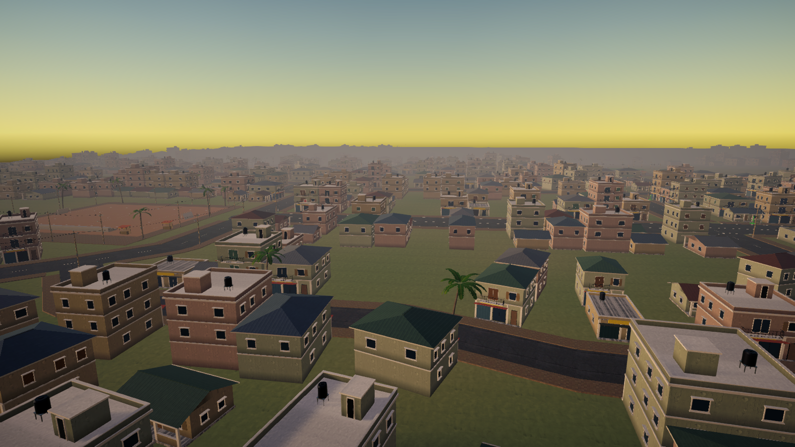
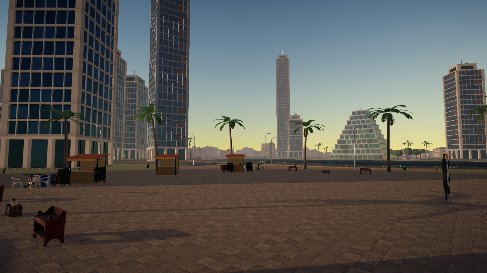
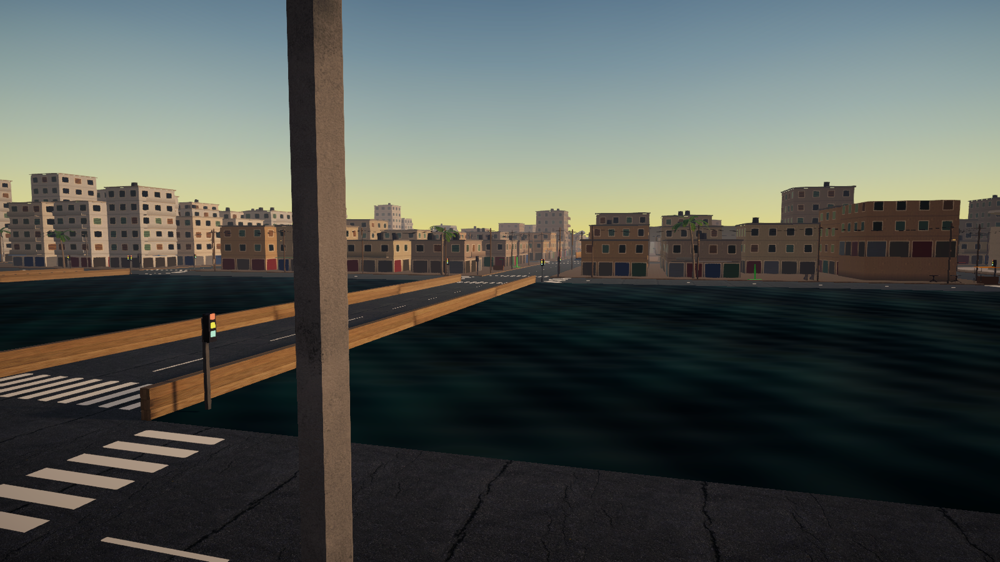
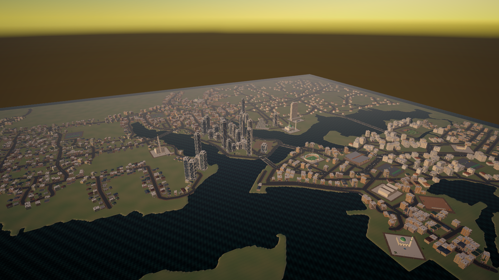
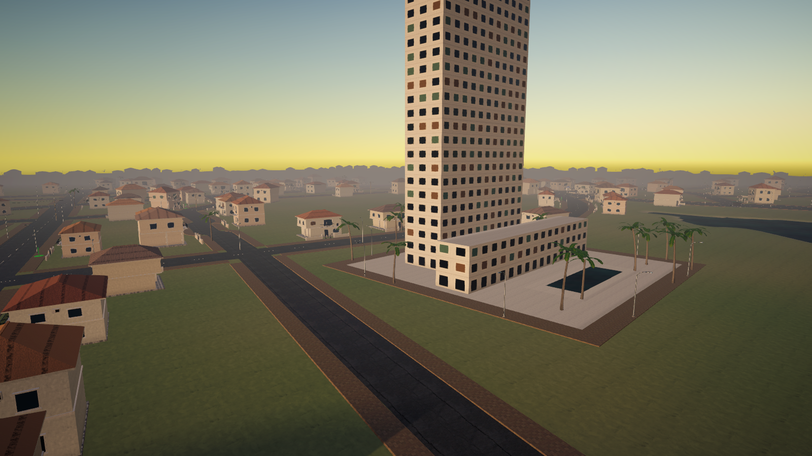
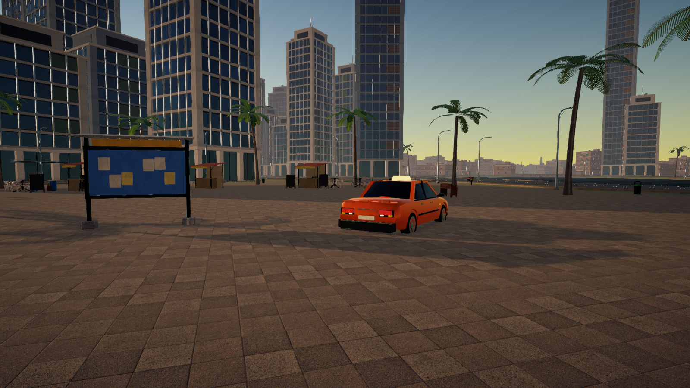
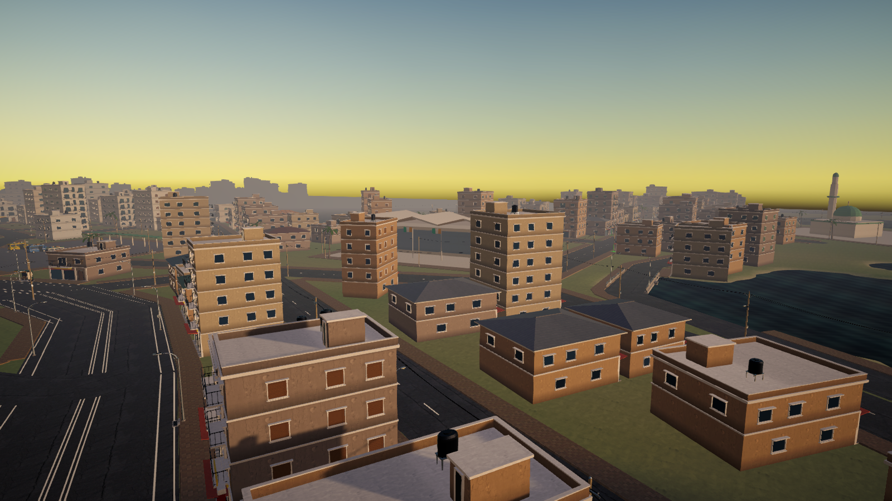
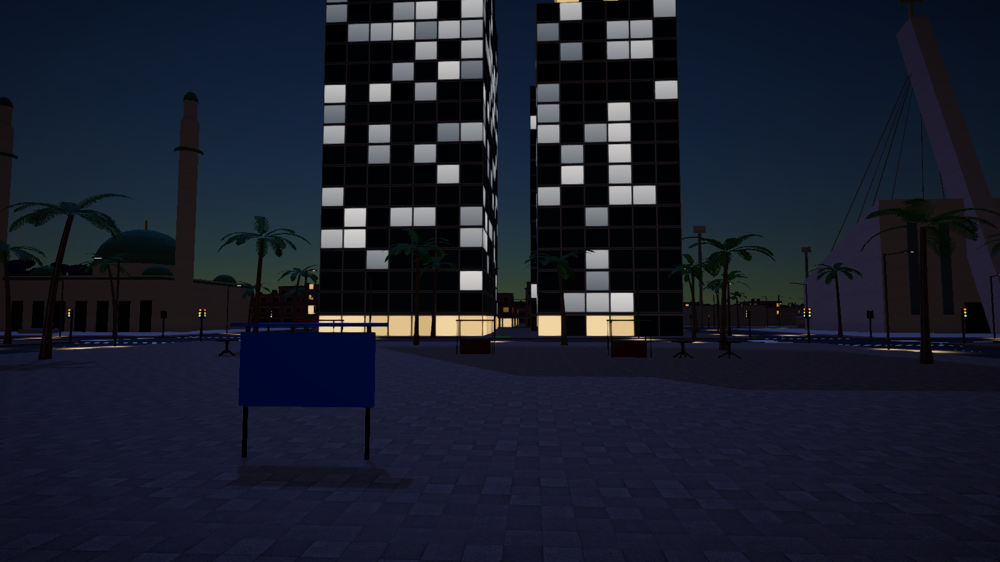
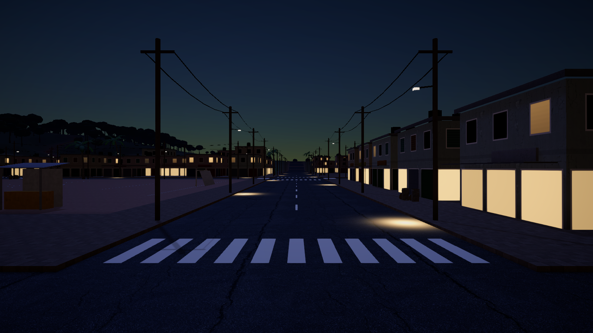
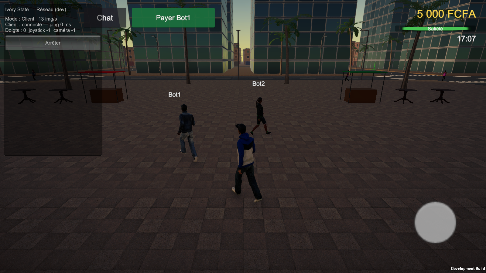

# Ivory State

Jeu de simulation multijoueur en monde ouvert sur mobile (iOS/Android), dans une ville africaine moderne inspirée d'Abidjan.

## Stack

| Brique | Choix |
|---|---|
| Moteur | Unity **6000.3.27f1** (Unity 6.3 LTS), pipeline de rendu **URP** (template « Universal 3D ») |
| Réseau | **FishNet 4.7.3** (installé via Git dans `Packages/manifest.json`), transport Tugboat (UDP). Le tag 4.7.4 publié sur GitHub ne compile pas (plugin Yak) : ne pas monter de version sans tester. |
| Autorité | Serveur dédié headless (Linux en production) |
| Backend persistant | Nakama (prévu, pas encore intégré) |

## Arborescence

```
ivory/
├─ IvoryState/                  Projet Unity
│  ├─ Assets/_Project/          Tout le contenu du jeu (le reste vient de packages ou du template)
│  │  ├─ Art/                   Animations, Materials, Models, Shaders, Textures, VFX
│  │  ├─ Audio/                 Ambience, Music, SFX
│  │  ├─ Prefabs/               Characters, Environment, UI, Vehicles
│  │  ├─ Scenes/                Bootstrap.unity (scène 0)
│  │  ├─ Settings/Network/      NetworkConfig.asset
│  │  ├─ UI/
│  │  └─ Scripts/               Un dossier = une assembly (.asmdef)
│  │     ├─ Core/               IvoryState.Core : démarrage réseau, configuration, logs
│  │     ├─ Gameplay/           IvoryState.Gameplay : code partagé client/serveur (NetworkBehaviours)
│  │     ├─ Client/             IvoryState.Client : UI, entrées, caméra (côté joueur)
│  │     ├─ Server/             IvoryState.Server : logique serveur uniquement (voir plus bas)
│  │     └─ Editor/             IvoryState.Editor : outils de setup et de build
│  └─ Builds/                   Sortie des builds (ignorée par git)
└─ backend/                     (à venir) Nakama + PostgreSQL via docker-compose
```

### Pourquoi une assembly serveur séparée

`IvoryState.Server` ne se compile que si `UNITY_SERVER`, `UNITY_EDITOR` ou `IVORY_SERVER` est défini.
**Les builds clients ne contiennent donc aucune logique serveur** : rien à décompiler côté économie ou validation.
Aucune autre assembly ne la référence. Elle s'enregistre seule au démarrage via `RuntimeInitializeOnLoadMethod`
et ajoute ses composants au moment où le serveur démarre.

Règle : tout ce qui décide (argent, inventaire, validation d'action) va dans `Server/`.
Tout ce qui doit exister des deux côtés (NetworkBehaviours, SyncVars, RPC) va dans `Gameplay/`.

## Git

- `Library/`, `Builds/`, `Logs/`, `UserSettings/` et les fichiers d'IDE sont ignorés (`.gitignore`).
- **Avant d'ajouter des modèles, textures ou sons : installer [Git LFS](https://git-lfs.com)**, puis activer
  les lignes LFS dans `.gitattributes`. Sinon les binaires alourdiront définitivement l'historique.
- Fusion intelligente des scènes et prefabs (facultatif) : déclarer UnityYAMLMerge, fourni avec l'éditeur.

```bash
git config merge.unityyamlmerge.driver "'C:/Program Files/Unity/Hub/Editor/6000.3.27f1/Editor/Data/Tools/UnityYAMLMerge.exe' merge -p %O %B %A %A"
```

## Première ouverture

1. Ouvrir `IvoryState/` dans Unity Hub avec **6000.3.27f1**.
2. Menu **Ivory State › Setup › Générer le bootstrap réseau**. Cette commande crée `NetworkConfig`,
   le prefab `PF_Player` et la scène `Bootstrap`. On peut la relancer sans risque.
3. Ouvrir `Assets/_Project/Scenes/Bootstrap.unity` puis lancer le Play Mode.
   Le panneau de dev en haut à gauche propose trois boutons : **Serveur**, **Client** et **Hôte**.

## Tester en local

| Méthode | Comment |
|---|---|
| Seul, le plus rapide | Play Mode, puis **Hôte**. Une capsule joueur apparaît. |
| Serveur + plusieurs clients | **Ivory State › Build › Serveur Windows (test local)**, lancer `Builds/Server-Windows/run_server.bat`. Ensuite, dans l'éditeur, Play Mode puis **Client**. On peut aussi lancer **Build › Client Windows** plusieurs fois. |
| Plusieurs joueurs dans l'éditeur | Installer *Multiplayer Play Mode* (Package Manager). |

Arguments de ligne de commande reconnus :

```
-server | -client | -host     rôle réseau
-address <ip>                 adresse du serveur (client)
-port <port>                  port UDP (7770 par défaut)
-maxPlayers <n>               joueurs max par instance (serveur)
-bot                          le client se déplace seul (builds de dev) : tests auto et tests de charge
-serverBots <n>               le serveur simule n personnages (tests de charge)
-botSpread <m>                rayon de déambulation des bots, 0 = foule serrée
```

## Contrôles du personnage

| Action | Mobile | PC (éditeur, build de test) |
|---|---|---|
| Se déplacer | Joystick flottant : poser le pouce dans la zone bas-gauche | ZQSD (AZERTY) / WASD (QWERTY) |
| Courir | Pousser le pouce au-delà du cercle du joystick | Maj gauche |
| Caméra | Glisser sur la moitié droite de l'écran | Clic gauche glissé à droite (la souris simule le tactile) |
| Sauter | Bouton rond en bas à droite | Espace |

### Fonctionnement réseau du déplacement

Le serveur fait autorité, avec prédiction côté client (Client-Side Prediction de FishNet) :

1. Le client simule son mouvement **tout de suite**, sans latence ressentie.
2. Il n'envoie que ses **entrées** au serveur : 5 octets par tick (direction, angle de caméra, saut et course).
3. Le serveur rejoue la même simulation ; c'est sa position qui fait foi.
4. Le serveur renvoie l'état réel. En cas d'écart, le client se recale puis rejoue ses entrées non confirmées.
   L'enfant `Graphics` du prefab est lissé par `NetworkTickSmoother`, ce qui rend ces recalages invisibles.

Le client n'envoie jamais de position ni de vitesse, donc pas de téléportation ni de course plus rapide en trichant.
Les réglages (vitesses, saut, gravité) sont dans `PlayerMotor`, sur le prefab `PF_Player`.

| Script | Assembly | Rôle |
|---|---|---|
| `Gameplay/Player/PlayerMotor.cs` | Gameplay | Simulation prédite : Replicate et Reconcile |
| `Gameplay/Input/IMovementInputProvider.cs` | Gameplay | Interface d'entrées (découple le moteur de l'UI) |
| `Client/Input/MobilePlayerControls.cs` | Client | Tactile multi-doigts (EnhancedTouch), repli clavier |
| `Client/Input/VirtualJoystickView.cs` | Client | Affichage du joystick |
| `Client/Cameras/ThirdPersonCameraRig.cs` | Client | Caméra 3ᵉ personne avec anti-traversée des murs |
| `Client/Debugging/HeadlessBotInput.cs` | Client | Entrées automatiques (`-bot`) |

## La ville



Générée par `Editor/City/CityGenerator.cs`, appelé par **Ivory State › Setup**. La génération est déterministe
(graine fixe) : client et serveur ont exactement la même ville, donc les mêmes identifiants de points.

- **Plan :** grille de 9 × 9 cellules de 76 m (bloc de 64 m + rue de 12 m), soit environ 690 m de côté.
  Une **lagune** traverse la ville d'est en ouest. Deux **ponts** (x = −38 m et +38 m) relient les rives.
- **Quartiers :** au nord, le **Plateau** (tours de 30 à 110 m) au centre, **Adjamé** (commerces denses) au-dessus,
  **Cocody** (villas espacées) à l'est et **Yopougon** (populaire, très dense) à l'ouest. Au sud, **Treichville**
  (marchés) et **Marcory** (mixte).
- **Place du Plateau** (point d'apparition) : dépôt de livraison et deux étals.
- **136 points d'interaction :** une à deux adresses de livraison par bloc, des étals de nourriture dans les quartiers
  commerçants (garba, alloco, attiéké poisson, brochettes) et un dépôt par quartier. Livraisons à pied de 30 à 250 m.
- **NavMesh** calculé à la génération : bots de test (et plus tard piétons et véhicules PNJ).
- **Optimisations mobiles :**
  - un seul maillage par bloc pour tous les immeubles, avec la teinte portée par les sommets : un draw call par bloc ;
  - un BoxCollider par bâtiment (pas de MeshCollider) ;
  - brume chaude à partir de 45 m et rendu coupé à 450 m.

### Rendu réaliste (direction artistique validée le 2026-11-16)

La cible est une version mobile des images de référence : Abidjan en 3D réaliste, lumière dorée de fin de journée, nuits animées. Tout est produit par **Ivory State › Setup** à partir de textures libres et de code (licences dans [docs/THIRD_PARTY.md](docs/THIRD_PARTY.md)).

- **Façades** (`Art/Shaders/Facade.shader`) :
  - enduit Poly Haven teinté par immeuble ;
  - fenêtres calculées par le shader, sans texture ni géométrie : vitres qui reflètent le ciel, persiennes, encadrements, bandeaux d'étage ;
  - au rez-de-chaussée, rideaux métalliques peints, boutiques ouvertes ou vitrines ;
  - la nuit, une partie des fenêtres et des boutiques s'allume.
  - Un style par quartier :

    | Quartier | Style |
    |---|---|
    | Yopougon, Adjamé, Treichville | populaire, enduit écaillé |
    | Marcory | immeubles à balcons |
    | Cocody | villas |
    | Plateau | tours à murs-rideaux |

  - Coût : 3 lectures de texture par pixel.
- **Volumes** : dalles de toit débordantes, balcons, auvents en tôle, enseignes, réservoirs d'eau noirs sur les toits, couronnes de tours.
- **Rues** :
  - asphalte, trottoirs et place en textures PBR ;
  - marquages et passages piétons ;
  - lampadaires modernes, ou poteaux en bois et fils électriques dans les quartiers populaires ;
  - cocotiers générés en code (environ 250 triangles chacun) ;
  - terrasses de maquis (tables, chaises monobloc, casiers) devant les étals ;
  - sacs, pneus et bidons le long des façades.
- **Lagune** (`Water.shader`) : vagues calculées sans texture, reflet du ciel, reflets chauds la nuit. Elle se prolonge au-delà de la carte.
- **Lumière** (`CityLighting`, `DayNightCycle`) :
  - ciel procédural et ambiance à trois couleurs ;
  - soleil qui se couche à l'ouest : une façade dorée, l'autre à l'ombre ;
  - brume chaude et ombres douces ;
  - post-traitement : tonemapping ACES, bloom au quart de résolution, étalonnage chaud, vignette ;
  - la nuit, lune froide, et la variable globale `_IvoryNight` allume fenêtres, ampoules et halos au sol (aucune vraie lumière, trop coûteuse sur mobile) ;
  - le jeu commence à 16 h 30.
- **Personnages** : sept avatars réalistes Microsoft Rocketbox (MIT) remplacent les capsules, pour les joueurs comme pour les passants.
  - Animations : attente, marche et course, mélangées selon la vitesse.
  - L'apparence d'un joueur dépend de son identifiant réseau : tout le monde le voit pareil, sans aucun message.
  - Textures réduites à 1024 px (reliefs 512).
  - Les passants n'ont pas d'ombre et disparaissent de loin.
- **Taxi** (`TaxiModelBuilder`) : berline orange modélisée en code. Phares, feux et lumignon « TAXI » s'allument la nuit.

Les ressources téléchargées sont versionnées. Pour les reproduire :

```
powershell -File tools/fetch-assets.ps1
```

```
powershell -File tools/fetch-characters.ps1
```

Captures : **Ivory State › Captures d'écran de la ville** (ou `-executeMethod IvoryState.Editor.City.ScenePreviewCapture.CaptureAll`
en batchmode sans `-nographics`) écrit dans `docs/screenshots/`.

| | |
|---|---|
|  |  |
|  |  |
|  |  |
|  |  |

## Vie de la ville



- **Apparence et noms :** chaque joueur a un avatar choisi d'après son pseudo (hachage stable). Il est
  identique à chaque relance et sur tous les écrans, sans aucun échange réseau. Son nom s'affiche au-dessus
  de sa tête jusqu'à 20 m.
- **Carte** (`MapHud`) : la ville vue du ciel est rendue une fois à la génération (`MapBaker`,
  `T_CityMap.png`), sans caméra supplémentaire en jeu.
  - Mini-carte ronde en haut à droite, qui tourne avec la caméra et montre le nord et la destination en cours.
  - Un tap ouvre la carte plein écran, nord en haut.
  - **Ivory State › Recalculer la carte** refait l'image seule.
- **Boussole** (`CompassHud`) en haut de l'écran, et **barre de chat** dessous avec les 3 derniers messages.
- **Éclairage public de nuit** (`StreetLightPool`) : les 580 lampadaires sont recensés à la génération, et
  8 vraies lumières se placent sur les plus proches de la caméra. Le reste de la ville garde ses ampoules
  et halos peints, peu coûteux.
- **Passants d'ambiance** (`Client/World/AmbientPedestrians`) : 20 figurants locaux (avatars réalistes animés) marchent sur le NavMesh
  autour de la caméra (apparition entre 25 et 70 m, disparition au-delà de 90 m). **Zéro réseau** : chaque
  téléphone a les siens, le serveur ne les connaît pas.
- **Jour et nuit** (`DayNightCycle`) : l'heure est calculée à partir du tick FishNet, déjà synchronisé, donc la
  même pour tous sans message. Une journée dure 24 min et commence à 16 h 30 : heure dorée, puis nuit avec la ville
  allumée. L'horloge s'affiche dans le HUD.
- **Capture en jeu automatique :** `IvoryState.exe -client -screenshot chemin.png -screenshotDelay 22 -screenshotQuit`
  (build de dev, fenêtré). Sert à la vérification visuelle sans intervention humaine.

## Taxis

Neuf **taxis orange** (comme les taxis compteurs d'Abidjan) attendent aux stations (`TaxiStand`) : deux de chaque
côté de la place du Plateau et un par quartier. Le serveur les fait apparaître au démarrage.

- **Monter / descendre :** près d'un taxi libre, le bouton d'action affiche « Monter dans le taxi ». Au volant,
  il affiche « Descendre du taxi ».
- **Conduite :** joystick haut/bas pour accélérer et freiner (puis reculer), gauche/droite pour tourner
  (ZQSD sur PC). Vitesse max de 58 km/h. La caméra recule et se replace derrière le taxi quand il roule.
- **Réseau :** même principe que la marche. En montant, le joueur reçoit la **propriété** du taxi et le
  pilote avec prédiction. Le serveur rejoue les entrées (2 octets par tick) pour faire foi, puis reprend
  la propriété à la descente. À l'arrêt et sans conducteur, un taxi ne génère quasiment aucun trafic.
- **Sécurité :** le serveur vérifie la distance (4,5 m) et que la place est libre. Si le conducteur se
  déconnecte, le taxi reste dans la rue, libre (`_preventDespawnOnDisconnect`).
- **Collisions :** les véhicules (couche `Vehicle`) ne heurtent que le décor. Ils traversent piétons et autres
  véhicules, pour la même raison que les piétons entre eux (pas de corrections visibles).
- **Descente déterministe :** le serveur et le client placent tous deux le joueur à côté de la portière.
  Sinon, le client ne l'apprendrait qu'à son premier pas : FishNet n'envoie pas de recalage tant que les
  entrées sont neutres. Bug trouvé par le test automatique.

**Test :** `-e2eDrive`. Le client marche jusqu'au taxi le plus proche, monte, accélère 6 s, freine et descend.

### Métier de chauffeur

Au volant, sans autre mission, le serveur propose au bout de 3 s **un client à prendre** à 40-200 m.
On s'arrête près de lui (moins de 8 m, moins de 3 m/s) : il monte et donne sa **destination**, à 150-500 m.
Paie : **500 FCFA + 6 FCFA/m**. Descendre du taxi ou dépasser le délai annule la course.
Le HUD affiche « Client à prendre » ou « Déposer le client », avec la balise et le chrono.
Logique serveur : `Server/Economy/TaxiFareService.cs`.

**Test :** `-e2eFare`. Un bot monte dans un taxi et **conduit seul** sur le NavMesh (braquage vers le prochain
virage, freinage à l'approche, marche arrière s'il est coincé). Il prend le client, le dépose et vérifie le paiement.
Dernier résultat : +2 075 FCFA en 56 s (119 m puis 264 m).

**Fiabilité de la descente :** l'instabilité a été détectée par la suite e2e (1 échec sur 5), puis corrigée en trois points :
1. Au volant, le personnage envoie des entrées **neutres**. Le joystick pilote le taxi, et des entrées encore en file
   d'attente ne font plus marcher le personnage après la descente.
2. Après la téléportation, le serveur envoie la position sur le canal **fiable**. FishNet l'envoie même quand ses
   renvois automatiques sont épuisés.
3. Le client **ignore les recalages antérieurs** à son placement de sortie. Ces états d'avant la descente peuvent
   arriver après lui, car l'ordre n'est pas garanti entre canaux.

Résultat : 8 réussites sur 8 passages consécutifs.

## Pseudos

Au premier lancement, un panneau « Choisis ton pseudo » s'affiche. Le pseudo est mémorisé sur l'appareil
(`PlayerPrefs`) et renvoyé automatiquement ensuite. Le serveur valide : 3 à 16 caractères (lettres avec accents,
chiffres, espace, tiret), espaces compactés, unicité parmi les connectés (« Kouassi » pris donne « Kouassi2 »),
un changement toutes les 5 s au maximum. Option de test : `-pseudo Nom`.

## Chat de proximité

On parle aux joueurs autour de soi (30 m), comme dans la rue.

- **Phrases rapides** en un tap (pas de clavier sur mobile) : « On dit quoi ? », « C'est comment ? »,
  « Ça va un peu ! », « Bonne arrivée ! », « Merci, on est ensemble ! », « On va au maquis ? »…
- **Texte libre** : clavier natif sur mobile. Sur PC, **T** ouvre le chat, **Entrée** envoie, **Échap** ferme.
- **Bulles** au-dessus des têtes (5 s) et **historique** des 5 derniers messages.
- **Serveur** (`PlayerChat` + `Server/Social/ChatService`) : 120 caractères maximum, 3 messages d'affilée
  puis 1 par seconde, balises et caractères de contrôle retirés. Le texte n'est jamais interprété comme
  du texte enrichi à l'affichage.
- Le message est remis via le `PlayerChat` **du destinataire** : il apparaît dans l'historique même si
  l'émetteur n'est pas affiché (plafond de joueurs visibles).
- Les menus UGUI utilisent un EventSystem. Les contrôles tactiles ignorent les touches qui commencent
  sur un menu (`MobilePlayerControls.RegisterBlockingRect`).

**Test :** `-e2eChat` (écoute) et `-e2eChatSay` (envoie, dont un message piégé). Dernier résultat :
les 2 joueurs proches reçoivent tout, `<b>balise</b>   et    espaces` donne « balise et espaces »,
et 300 caractères sont coupés à 120.

## Transferts entre joueurs

Près d'un autre joueur (4 m), un bouton **« Payer [pseudo] »** apparaît. On choisit 500, 1 000, 2 000 ou 5 000 FCFA, ou
un montant libre, puis on confirme. Le serveur (`Server/Economy/TransferService.cs`) vérifie que le destinataire est un
vrai joueur connecté (pas un bot, pas soi-même), mesure la distance sur ses propres positions (4 m + 1,5 m de
tolérance), exige un montant entre 100 et 100 000 FCFA et un solde suffisant, et limite à un transfert toutes les 2 s.
Les deux joueurs sont notifiés. Avec Nakama, l'historique note « transfert vers / de ».
Test : scénario « Transfert entre joueurs » de `tools/e2e.ps1`.

## Reconnexion automatique

Si la connexion échoue ou se coupe (Wi-Fi ou 4G instable, serveur redémarré), le client réessaie seul après 2, 4, 8, 16,
puis toutes les 30 s. Ça ne s'applique pas après un arrêt volontaire. Avec Nakama, le profil est rechargé à la reconnexion.

Le panneau de développement affiche aussi les **images par seconde** et un diagnostic tactile (doigts posés,
doigt du joystick, doigt de la caméra).

## Sauvegarde des joueurs (Nakama)

L'argent, le pseudo et la satiété sont sauvegardés dans **Nakama 3.41** (avec PostgreSQL 16), qui tourne dans Docker.

```bash
cd backend
powershell -File setup-keys.ps1
powershell -File up.ps1
```

`up.ps1` réutilise un Nakama qui répond déjà sur le port 7350 (par exemple lancé depuis une autre copie du projet) et
ne lance la pile Docker de cette copie que s'il n'y en a aucun. La pile porte un nom de projet Compose propre à cette
copie (`ivory-onedrive-backend`) : un `docker compose up` ou `down` lancé ici ne touche jamais aux conteneurs d'une autre copie.

`setup-keys.ps1` crée `backend/.env` avec des secrets aléatoires, une seule fois. Ce fichier est ignoré par git.
La console d'administration est sur http://127.0.0.1:7351 (utilisateur `admin`, mot de passe dans `.env`) : comptes,
portefeuilles avec l'historique de chaque gain et dépense, profils.

**Fonctionnement :**
1. Le téléphone ouvre une session Nakama avec un identifiant d'installation : un GUID mémorisé, et non un identifiant matériel.
2. Il transmet le jeton au serveur de jeu, qui le **vérifie auprès de Nakama** puis charge le profil.
3. Chaque gain ou dépense est appliqué au **portefeuille Nakama** dans l'ordre, avec sa raison (« achat : un garba »,
   « course de taxi : … »), de façon atomique. Nakama refuse tout solde négatif.
4. Le profil (pseudo, satiété) est sauvegardé toutes les 60 s et à la déconnexion.

**Sécurité :** les RPC (`backend/modules/ivory.lua`) refusent tout appel venant d'un client. Seul le serveur de jeu,
muni de la clé **http secrète** (`NAKAMA_HTTP_KEY`, jamais dans l'app), peut créditer ou débiter. Un même compte ne
peut pas être connecté deux fois. Aucun SDK n'est nécessaire : 3 appels REST (`Core/Backend/NakamaHttp.cs`).

**Configuration du serveur de jeu :** argument `-nakamaHttpKey` / `-nakamaUrl`, ou variables `IVORY_NAKAMA_HTTP_KEY` /
`IVORY_NAKAMA_URL`. En développement, `backend/.env` est trouvé automatiquement. Sans clé, le serveur passe en
**mode hors-ligne** (argent en mémoire), comme avant.

**Test :** `powershell -ExecutionPolicy Bypass -File tools/e2e-persist.ps1`. Un joueur gagne de l'argent, se
déconnecte, le serveur de jeu redémarre, puis le joueur revient et doit retrouver son solde et son pseudo.

## Économie et interactions

Toute la logique se trouve côté serveur (`Server/Economy/EconomyService.cs`, absent des builds clients).

| Élément | Règle |
|---|---|
| Argent | Franc CFA, entiers (`long`). Départ : 5 000 FCFA. Visible uniquement par son propriétaire, modifiable uniquement par le serveur. |
| Satiété | De 100 à 0, perd 1 point toutes les 20 s (vrais joueurs uniquement). **À 0, impossible de courir** : règle appliquée dans la simulation de mouvement, donc aussi par le serveur. |
| Étals | Garba 1 000 FCFA (+40), alloco 500 FCFA (+20). Refusé si le joueur est rassasié ou n'a pas assez d'argent. |
| Livraisons | Le dépôt attribue une adresse à 30 m minimum. Paie = 300 + 15 FCFA/m (arrondi à 25). Délai calculé à allure de marche + 25 s. |

**Points d'interaction** (`WorldInteractable` : `ShopPoint`, `JobBoardPoint`, `DeliveryPoint`) : ce sont des objets
statiques de la scène, **sans objet réseau**, chacun avec un identifiant stable. Le client envoie seulement
« j'interagis avec n° 12 ». Le serveur revérifie que le point existe, mesure la distance sur sa propre position
du joueur et applique une cadence maximale, puis utilise **ses** prix. Coût réseau nul pour des milliers de commerces.

**Contrôles :** le bouton d'action apparaît près d'un point (touche **E** sur PC).

**Test de bout en bout :** `IvoryState.exe -batchmode -nographics -client -address 127.0.0.1 -e2eEconomy`.
Le client joue seul le parcours livraison, paiement et achat, et écrit `[E2E] RÉUSSI` ou `ÉCHEC` dans son log.
Dernier résultat : réussi en 66 s (+1 150 FCFA de livraison, garba acheté).

**Pas encore fait :** persistance (le solde est perdu à la déconnexion, à brancher sur Nakama)
et échanges d'argent entre joueurs.

## Performance sur téléphone

Mesures faites le 2026-11-16 sur un TECNO CK6 (Helio G99, écran 2400 × 1080), jeu en mouvement :

| Réglages | img/s |
|---|---|
| Complets | 19 |
| Post-traitement allégé (sans HDR, bloom ni FXAA) | 18 |
| **Sans post-traitement** | **29** (plafond de 30 atteint) |
| Sans post-traitement, résolution 0,7 | 28,5 |

La passe de post-traitement plein écran est ce qui coûte. Sur téléphone, `MobileRenderQuality` la coupe donc au lancement, et `NetworkBootstrap` plafonne à 30 img/s. L'ambiance reste portée par la lumière (soleil doré, brume chaude), les façades et les lumières de nuit. Le PC garde le post-traitement complet.

Ces réglages s'appliquent en jeu, sans modifier les assets URP. Changer par script les réglages qui touchent aux mots-clés de shader rend tout noir sur Android.

**Construire l'APK** (Unity fermé). Il faut toujours lancer Unity avec `-buildTarget Android` :

```
Unity.exe -batchmode -quit -buildTarget Android -projectPath IvoryState -executeMethod IvoryState.Editor.AndroidSetup.ConfigureAndBuild
```

Si Unity passe de Windows à Android dans la même session, URP élimine toutes les variantes de shader d'affichage et l'APK reste sur un écran noir. Le script refuse donc de construire si le projet n'est pas déjà sur Android.

Après un build, vérifier dans le log que `Universal Render Pipeline/Lit`, `IvoryState/Facade` et `UberPost` ont bien `total internal programs` supérieur à 0.

Pour mesurer sur un téléphone branché en USB (débogage USB actif, serveur lancé sur le PC) :

```
powershell -File tools/phone-perf.ps1
```

```
powershell -File tools/phone-perf.ps1 -Options "-quality high"
```

Options disponibles (`PerfProbe`) :

| Option | Effet |
|---|---|
| `-quality high` | réglages complets |
| `-renderScale x` | change la résolution de rendu |
| `-noPost` | coupe le post-traitement |
| `-noShadows` | coupe les ombres |
| `-pedestrians n` | fixe le nombre de passants |
| `-fps n` | fixe la fréquence d'images visée |

Le téléphone chauffe vite : il faut comparer à température égale, par exemple en refaisant la mesure de référence entre deux tests.

## Tests de bout en bout

Après les builds Windows serveur et client :

```bash
powershell -ExecutionPolicy Bypass -File tools/e2e.ps1
```

Lance successivement les trois scénarios joués par des clients headless : économie, conduite et chat.
Affiche un verdict par scénario et sort avec le code 0 si tout est vert (utilisable en CI).
**À lancer avant chaque commit qui touche au gameplay.**

## Gestion de l'intérêt et tests de charge

**Gestion de l'intérêt :** `HashGrid` (plan XZ, cellules de 50 m) et `GridCondition` sont appliqués par défaut à tous
les objets réseau. Un client ne reçoit que les objets des 3 × 3 cellules autour de lui, soit environ 50 à 100 m de vue.
La taille des cellules se règle dans `IvoryProjectSetup.InterestCellSize`.

**Test de charge :** construire « Serveur Windows » et « Client Windows » (menu Ivory State › Build), puis :

```bash
powershell -File tools/loadtest.ps1 -ServerBots 96 -Clients 4 -Spread 180 -Label disperse
```

Le serveur simule `-ServerBots` personnages avec le même `PlayerMotor` que les vrais joueurs. `-Clients` vrais clients
headless mesurent ce qu'ils reçoivent. Les résultats sont écrits dans `loadtests/` (ignoré par git).

**Plafond de joueurs visibles :** `NearestPlayersCondition` s'ajoute à la grille. Chaque client ne reçoit que ses
`MaxVisiblePlayers` voisins les plus proches (32 par défaut, dans `NetworkConfig`), avec une marge pour éviter
le clignotement. C'est ce qui protège la bande passante dans un marché ou un maquis bondé.

**Corrections serveur à 10 Hz :** `PlayerMotor._serverReconcileInterval = 3`. Les entrées partent toujours
à 30 Hz, mais l'état qui fait foi n'est envoyé qu'un tick sur 3, décalé d'un objet à l'autre pour lisser le trafic.

Pour comparer des réglages : `-MaxVisible 0` (pas de plafond) ou `-MaxVisible 20` dans le script.

### Résultats de référence (2026-11-15, i5-7200U 2 cœurs, serveur et clients sur la même machine)

| Scénario (100 joueurs) | CPU serveur | Joueurs vus par client | Reçu par client | Sortant serveur estimé |
|---|---|---|---|---|
| Foule, avant optimisation | 56 % d'un cœur | 100 | ~149 Ko/s (~520 Mo/h) | ~14,5 Mo/s |
| Foule, corrections à 10 Hz | 56 % d'un cœur | 100 | ~108 Ko/s (~380 Mo/h) | ~10,5 Mo/s |
| **Foule, 10 Hz + plafond de 32** | 52 % d'un cœur | 37 (stable) | **~40 Ko/s** (~140 Mo/h) | ~3,9 Mo/s |
| Dispersés, avant optimisation | 16 % d'un cœur | 17 | ~27 Ko/s | ~2,6 Mo/s |
| **Dispersés, optimisé** | **14 %** d'un cœur | 10* | **~12 Ko/s** (~41 Mo/h) | ~1,1 Mo/s |

\* Le nombre de joueurs vus en dispersé varie selon les trajectoires aléatoires (de 9 à 24 dans un même test).
L'indicateur stable est le **coût par joueur visible** : 1,5 Ko/s avant, puis **~1,05 Ko/s** après
(environ 35 octets par tick).

### Fluidité : les joueurs se traversent

Lors du test à la main, l'utilisateur a constaté des saccades, et la mesure d'erreur de prédiction
(`[ClientStats] erreur_*`, intégrée au script) en a trouvé la cause : les collisions entre personnages.
Le client simule ces collisions avec des positions distantes en retard, le serveur avec les vraies.

| Foule de 100 joueurs | Avec collisions | Sans collisions (actuel) |
|---|---|---|
| Erreur de prédiction moyenne / max | 2,5 cm / **3,47 m** | **0,0 cm / 0,1 cm** |
| Corrections visibles (> 5 cm) par 5 s | 4,6 | **0** |
| CPU serveur | 53 % d'un cœur | **18 %** |

Les joueurs sont donc sur la couche `Player` (8), qui ne collisionne pas avec elle-même (`GameLayers`).
La caméra et la détection du sol ignorent aussi cette couche. Les corrections serveur sont passées à 15 Hz,
et le plafond à 28 joueurs visibles : en foule, ~33 joueurs vus pour environ 40 Ko/s.
L'argument `-PlayerCollisions` du script refait la comparaison.

Ce qu'il faut en retenir :
- Le pire cas (foule) est passé de ~149 à ~40 Ko/s par téléphone, soit 3,8 fois moins.
- Leviers restants si besoin : compression de l'état (position quantifiée), moins d'envois pour les joueurs
  éloignés, retransmissions des entrées réduites (`PredictionManager` › State Interpolation, au prix d'une
  moins bonne tolérance aux pertes de paquets).
- Le chiffre CPU de la foule n'est pas fiable : les 4 clients headless saturent ce PC double cœur.
  Il faudra refaire la mesure avec le serveur sur une machine séparée (VPS Linux).
- On observe environ 1 passage du ramasse-miettes par seconde côté serveur (`gc0`). La source reste à identifier.
- En `-batchmode`, Unity ignore `targetFrameRate`. `HeadlessFrameLimiter` limite donc le serveur à 60 fps,
  sans quoi il tournait à 340 fps et consommait 2 fois plus de CPU.

## Modules Unity à installer (Unity Hub › Installs › ⚙ › Add modules)

Actuellement, seul le module Windows (Mono) est installé. À ajouter :

- **Android Build Support** (avec OpenJDK et Android SDK/NDK) : client Android
- **iOS Build Support** : client iOS (la compilation finale demande un Mac)
- **Linux Dedicated Server Build Support** : serveur de production
- **Windows Build Support (IL2CPP)** : facultatif

## Réglages réseau (NetworkConfig)

- **Tick rate 30** : simulation serveur à 30 Hz, bon compromis entre bande passante et réactivité sur mobile.
  Le serveur headless cale aussi sa boucle sur ce rythme pour économiser le CPU.
- **Max players 100** par instance de la ville. Au-delà, on lance une instance de plus.
- **Editor Launch Mode** : démarre automatiquement en Serveur, Client ou Hôte dans l'éditeur (None = panneau de dev).
